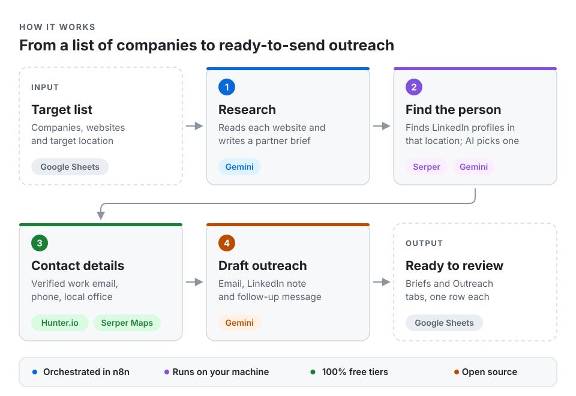
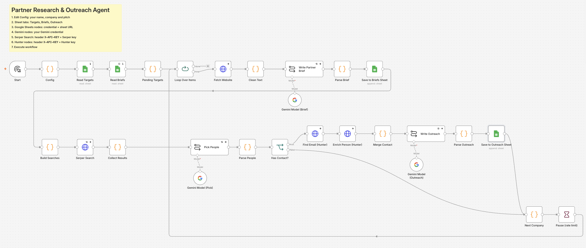
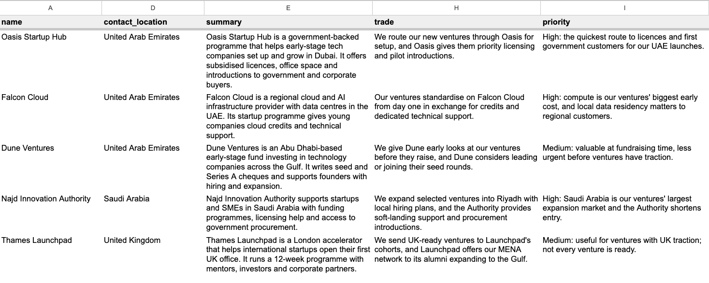
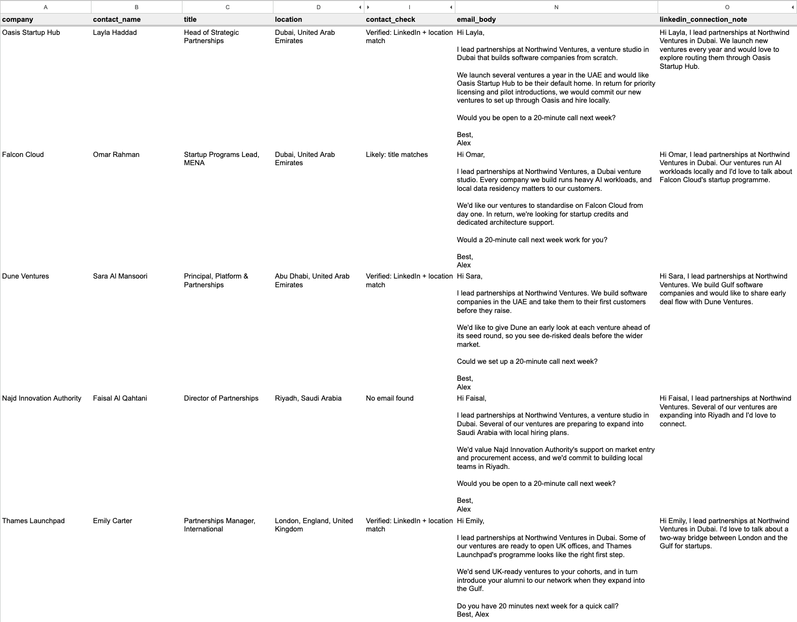

# Partner Research & Outreach Agent

**An AI agent that turns a list of target companies into partner briefs, the right contact in the right country, and ready-to-send outreach.** Built in n8n.


- **100% free:** runs entirely on free tiers (n8n self-hosted, Gemini, Serper, Hunter.io).
- **Location-aware:** finds the partnerships person in the country you choose, e.g. a company's UAE team rather than its US headquarters.
- **Open source:** MIT licence; use it, fork it, adapt it.
- **Reproducible:** import one workflow file, add your free API keys, run.

<picture>
  <source media="(prefers-color-scheme: dark)" srcset="assets/architecture-dark.svg">
  
</picture>

---

## What you get for every company

| Briefs tab (one row per company) | Outreach tab (one row per contact) |
| --- | --- |
| What they do | Name, job title and location |
| What they want from a partner | LinkedIn profile |
| What you get from them | Work email and verification status |
| The trade that works for both sides | Direct and local office phone numbers |
| Priority, with a one-line reason | Personalised email |
| | LinkedIn connection note (under 200 characters) |
| | LinkedIn follow-up message |
| | Why this person was chosen, and a contact check |

---

## Screenshots

**The workflow in n8n**



**Briefs: one row per organisation**



**Outreach: the right contact at the same organisations, with drafts**



<sub>Screenshots use demo data with fictional organisations and people, and show the key columns only. Click any image to see it full size.</sub>

---

## Results from a real run

Tested on **36 public organisations** (startup programmes, accelerators, VC funds, cloud platforms and government bodies) across the UAE, Saudi Arabia, Qatar, Türkiye and the UK.

| Measure | Result |
| --- | --- |
| Companies where a relevant contact was found in the target location | **30 of 36 (83%)** |
| Contacts with a work email found | **59%** |
| Emails cross-checked against LinkedIn and location | **10** fully verified, others flagged for review |
| Briefs and outreach drafts written | **100%** of companies processed |
| Cost | **$0** |

## Time saved (estimate)

| Task per company (1 contact) | Manual | With the agent |
| --- | --- | --- |
| Research the company and write a brief | 15–25 min | ~3 min to review |
| Find the right person in the right country | 5–10 min | ~2 min to check the profile |
| Find and verify the email | 2–3 min | ~1 min |
| Find the local office phone | 2 min | 0 |
| Write an email and LinkedIn messages | 10–15 min | 3–5 min to edit |
| Log everything in a spreadsheet | 3–5 min | 0 |
| **Total** | **40–60 min** | **about 10 min** |

**About 75–80% less time per company.** For a list of 36 companies, that's roughly 24–36 hours of manual work reduced to about 6 hours of review. Set `contacts_per_company` to 2 or more and the saving grows, since each extra contact takes 15–20 minutes by hand.

---

## How it works

1. **Read the target list.** Companies already researched are skipped, so you can keep adding targets and re-running.
2. **Research.** The agent reads each company's website and Gemini writes a structured partner brief.
3. **Find the person.** Serper runs Google searches for public LinkedIn profiles matching the company, relevant roles and the target location. Gemini screens the results and keeps only people who currently work there, are based in that location, and hold a relevant role. A person is kept only if their profile link really appeared in the search results.
4. **Contact details.** Hunter.io finds the work email, verification status and phone number, and checks where the person is based. A `contact_check` column compares this with the LinkedIn result (LinkedIn, location and title) and flags anything that doesn't match. Google Maps (via Serper) finds the company's office in that location.
5. **Draft outreach.** Gemini writes a personalised email, a LinkedIn connection note and a follow-up message for each contact, using the brief.
6. **Write to Google Sheets.** Briefs and Outreach rows are appended for review. Nothing is sent automatically.

## Tech stack

| Tool | Role | Free tier |
| --- | --- | --- |
| [n8n](https://n8n.io) | Workflow orchestration, self-hosted | Free (Community Edition) |
| [Google Gemini](https://aistudio.google.com) | Briefs, contact screening, drafts | Free tier |
| [Serper.dev](https://serper.dev) | Google search and Maps API | 2,500 free searches |
| [Hunter.io](https://hunter.io) | Email finder and verification | 50 credits a month |
| Google Sheets | Input and output | Free |

---

## Repository contents

```
workflow/partner_research_outreach_agent.json   Import into n8n
docs/SETUP_GUIDE.md                             Step-by-step setup and troubleshooting
sample-data/targets.csv                         Example target list (public organisations)
sample-data/briefs_headers.csv                  Header row for the Briefs tab
sample-data/outreach_headers.csv                Header row for the Outreach tab
sample-data/demo_briefs.csv                     Demo output (fictional organisations)
sample-data/demo_outreach.csv                   Demo output (fictional contacts)
assets/                                         Architecture diagram
screenshots/                                    README images
```

## Quick start

1. Install [Node.js](https://nodejs.org) (LTS), then run `npx n8n` and open http://localhost:5678.
2. Create a Google Sheet with tabs `Targets`, `Briefs` and `Outreach`, using the header rows in `sample-data/`.
3. Get free API keys for Gemini, Serper and Hunter.io.
4. In n8n: **Import from File** → `workflow/partner_research_outreach_agent.json`.
5. Edit the **Config** node (your name, company and pitch), connect your credentials, and paste your sheet URL.
6. Click **Execute workflow**.

Full instructions: **[docs/SETUP_GUIDE.md](docs/SETUP_GUIDE.md)**

---

## Responsible use

- The agent only reads **public Google search results**; it never logs in to or scrapes LinkedIn.
- Nothing is sent automatically. Every email and LinkedIn message is a draft for a human to review and send.
- Use contact data only for relevant business outreach, honour opt-outs, and follow local data-protection law (e.g. GDPR).
- The workflow file contains no credentials or personal data. Keep it that way: never commit API keys, OAuth files or real contact data.

## Limits

- Google's LinkedIn snippets can be out of date. Always check a profile before reaching out.
- Direct mobile numbers are rare on free tools; the local office number is usually available.
- Organisations with few public LinkedIn profiles in the target location may return no contact.
- Free tiers have daily and monthly limits, so large lists may take more than one run.

## Ideas for extension

- Trigger runs from a CRM (e.g. Attio or HubSpot) and write results back to the record.
- Add a news step to mention each partner's latest announcement in the outreach.
- Run on a schedule from a small cloud server.

---

## Licence

MIT. See [LICENSE](LICENSE).

Built by **Syed Abdul Muiz Bokhari**.
